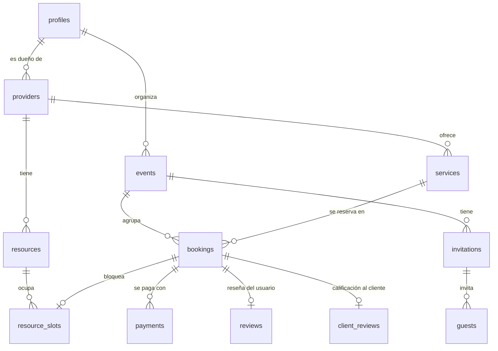
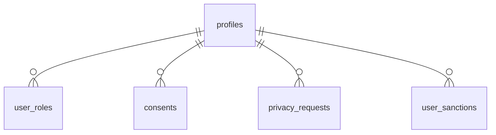
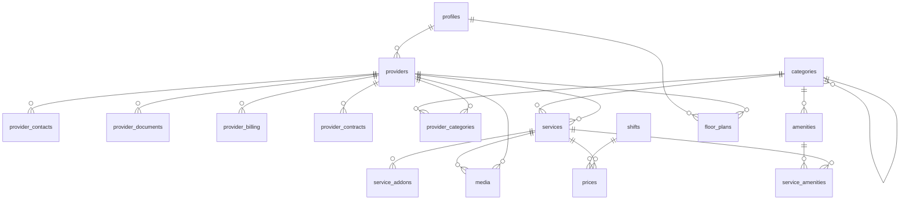
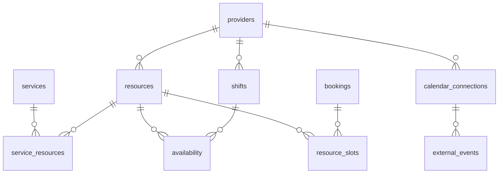
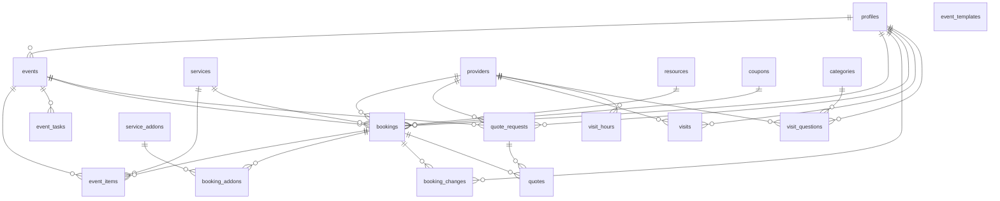
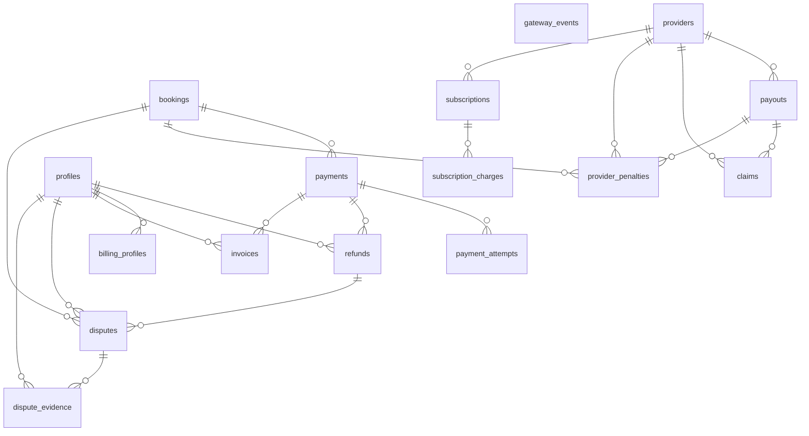
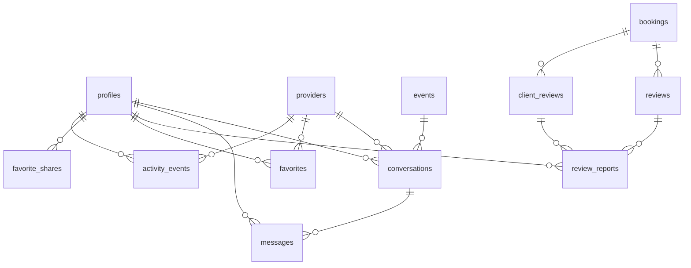
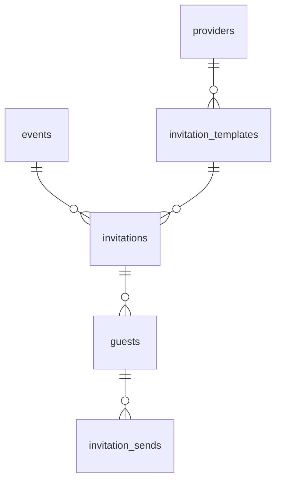
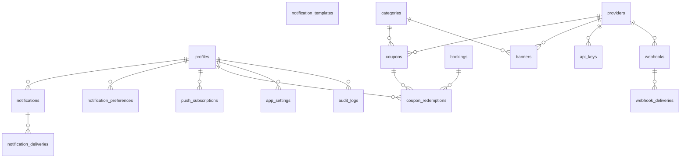

# ORGANICE · Modelo de datos (cimiento 1.3)

**Estado: aprobado por Nicolás y Ricardo (PR #3).** Las migraciones están en `supabase/migrations/`; todavía no se aplican al proyecto de Supabase en la nube.

76 tablas que cubren los 121 requisitos. Dueño **A** = Track A, **B** = Track B, **Compartida** = cambios solo con PR de ambos.

## Decisiones

Tomadas por Nicolás (26/11/2026), falta el visto bueno de Ricardo:

1. **Varios eventos a la misma hora:** sí, con "recursos". Cada recurso es un lugar o equipo que se ocupa (un salón tiene 1; un catering con 2 equipos, 2).
2. **Apartar sin pagar:** lo decide cada proveedor (`providers.requires_deposit_to_book`, por defecto exige anticipo). Sin pago, la fecha se bloquea 24 h; mientras se paga, 15 minutos. El contacto del proveedor se ve solo con el anticipo pagado.
3. **Reprogramación:** no es un estado. La reserva conserva su estado de pago y el cambio se guarda en `booking_changes`.
4. **Facturas:** `invoices` es solo para lo que factura ORGANICE; el servicio lo factura el proveedor (RF-036 corregido; confirmar con el contador).
5. **`resource_slots`:** tabla compartida.

6. **Estado `esperando_pago`:** con proveedores que exigen anticipo, dura 15 minutos con tarjeta o hasta 24 h con OXXO o SPEI, y pasa a `anticipo_pagado` o a `expirada`. La ventana de 24 h del proveedor empieza al recibir el pago.

Siguen por definir en las reglas de negocio (el modelo ya deja el espacio): política de cancelación, monto de la multa, proveedores fundadores y pasarela.

## Vista general



## Cómo se impide la doble reserva

Reservas, apartados temporales y bloqueos viven en una sola tabla, `resource_slots`, con una restricción de exclusión:

```sql
create extension if not exists btree_gist;

alter table resource_slots
  add constraint resource_slots_sin_traslape
  exclude using gist (resource_id with =, during with &&);
```

La base de datos rechaza dos rangos que se crucen en el mismo recurso, aunque dos personas reserven en el mismo segundo.

- `create_booking` crea la reserva y su rango en una sola transacción. Si el rango choca, no se crea nada.
- Un turno de "día completo" choca solo con los turnos de medio día, porque se comparan horas y no nombres.
- Al cancelar o expirar una reserva se borra su rango y la fecha se libera.
- Un apartado temporal (mientras se paga) tiene `expires_at`; los vencidos se limpian antes de intentar reservar y con una tarea programada.
- Si un evento de Google Calendar choca con una reserva, no la pisa: se marca el conflicto y se avisa al proveedor.

## Cuentas y privacidad

La contraseña, el login social, la verificación de email, el 2FA y las sesiones viven en `auth.users` de Supabase Auth; no se crean tablas propias para eso.



| Tabla | Dueño | Para qué | Columnas principales | RF |
|---|---|---|---|---|
| `profiles` | Compartida | Datos de la persona. Al eliminar la cuenta se anonimiza, no se borra. | id = auth.users.id<br>full_name, last_name, phone, phone_verified_at<br>avatar_url, birth_date, favorite_event_type<br>status (activa, suspendida, bloqueada, eliminada) | 1-4, 6-12, 82, 83 |
| `user_roles` | Compartida | Roles (usuario, proveedor, admin). Aparte de `profiles` para que nadie se lo cambie solo. | profile_id, role | 8, 82 |
| `consents` | Compartida | Aceptación de términos y aviso de privacidad. | profile_id, document, version, accepted_at, ip | 1, 109 |
| `privacy_requests` | B | Solicitudes ARCO y portabilidad. | profile_id, type, status, resolved_at | 12, 109 |
| `user_sanctions` | B | Suspensiones, bloqueos y advertencias. | profile_id, type, reason, ends_at, admin_id | 84, 120, 121 |

## Proveedores y catálogo

El contacto va en una tabla aparte: la seguridad por fila (RLS) protege filas, no columnas, y así el teléfono solo se lee después de apartar.



| Tabla | Dueño | Para qué | Columnas principales | RF |
|---|---|---|---|---|
| `providers` | B | Negocio. Parte pública. | owner_id, name, slug, description, history, founded_year<br>colonia, lat, lng, coverage_km, business_hours<br>status (pendiente, aprobado, rechazado, falta_info, suspendido)<br>verified_at, premium_badge, is_founder<br>deposit_pct (20 a 50), requires_deposit_to_book, cancellation_policy<br>payment_account_id, payout_frequency<br>rating_avg, cancel_rate, closing_rate (las dos últimas solo internas) | 20, 56, 57, 59, 74, 79, 85, 86, 105, 106 |
| `provider_contacts` | B | Teléfono, WhatsApp, email y redes. Visible solo tras apartar. | provider_id, phone, whatsapp, email, social | 20, 59, 71 |
| `provider_documents` | B | Identificación, constancia fiscal y revisión. | provider_id, type, file_path, status, reviewed_by | 56, 57, 85, 86 |
| `provider_billing` | B | RFC y CLABE cifrados a nivel de campo. | provider_id, rfc_enc, clabe_enc, bank, holder, verified_at | 56, 74 |
| `provider_contracts` | B | Contrato firmado, versión e IP. | provider_id, version, signed_at, ip, pdf_path, expires_at | 58 |
| `categories` | B | Las 7 categorías y subcategorías. | parent_id, name, slug, icon, color | 14, 96, 98 |
| `provider_categories` | B | Categorías que atiende cada proveedor. | provider_id, category_id | 14, 59 |
| `services` | B | Paquete o servicio que se reserva. | provider_id, category_id, name, description<br>capacity_min, capacity_max, duration_min<br>attributes (menú, etc.), included_items, search_vector, active | 15, 16, 20, 62, 94, 116 |
| `service_addons` | B | Extras con precio. | service_id, name, price | 62, 63 |
| `amenities` | B | Aire acondicionado, alberca, cocina, sonido… | name, category_id | 16, 25 |
| `service_amenities` | B | Qué incluye cada servicio. | service_id, amenity_id | 16 |
| `prices` | B | Precio base y reglas por temporada, día, turno o anticipación. | service_id, unit (fijo, persona, hora, dia), amount<br>season_start, season_end, weekday, shift_id, early_discount_pct | 63, 67 |
| `media` | B | Fotos, videos y tour 360. | provider_id, service_id, type, url, section, position, is_main, moderation_status | 20, 22, 23, 60, 61, 94, 114, 115 |
| `floor_plans` | B | Acomodo de mesas de un salón. | provider_id, owner_id, layout (json), capacity | 24 |

## Calendario y disponibilidad

Aquí está la protección contra la doble reserva (ver sección siguiente).



| Tabla | Dueño | Para qué | Columnas principales | RF |
|---|---|---|---|---|
| `resources` | B | Lo que se puede ocupar: un salón, un jardín, un equipo de catering. Si un proveedor puede atender 2 eventos a la vez, tiene 2 recursos. | provider_id, name, active | 64, 68 |
| `service_resources` | B | Qué recursos sirven para cada servicio. | service_id, resource_id | 62, 64 |
| `shifts` | B | Turnos que define cada proveedor. | provider_id, name, start_time, end_time | 21, 67 |
| `availability` | B | Bloqueos recurrentes y cierres (p. ej. cerrado los lunes). | resource_id, weekday, shift_id, from_date, to_date | 64 |
| `resource_slots` | Compartida | Cada rango de tiempo ocupado. Solo se escribe por funciones (RPC). | resource_id, during (tstzrange)<br>kind (reserva, apartado_temporal, bloqueo, externo)<br>booking_id, expires_at | 13, 21, 31, 32, 64, 68, 70 |
| `calendar_connections` | B | Google Calendar e iCal. Los tokens van cifrados. | provider_id, type, tokens_enc, ical_url, sync_minutes, last_sync_at | 65, 66 |
| `external_events` | B | Eventos importados; si chocan con una reserva se marcan y se avisa. | connection_id, external_id, during, conflict | 65, 66 |

## Eventos y reservas

Toda reserva pertenece a un evento. Los montos se copian a la reserva al crearla, para que un cambio de precio no altere reservas viejas.



| Tabla | Dueño | Para qué | Columnas principales | RF |
|---|---|---|---|---|
| `events` | A | La fiesta. | user_id, type, name, date, guest_count, budget<br>status (borrador, activo, pasado, cancelado), wizard_step | 27, 29, 30, 47, 55 |
| `event_items` | A | Lo elegido en el Armador, aún sin reservar o ya reservado. | event_id, service_id, booking_id, estimated_price | 27, 29, 30 |
| `event_templates` | A | Checklist por tipo de evento. | event_type, items (con esencial u opcional) | 28 |
| `event_tasks` | A | Checklist de cada evento. | event_id, title, essential, done_at, remind_at | 28, 47 |
| `bookings` | A | Reserva de un servicio. | event_id, user_id, provider_id, service_id, resource_id, during<br>guest_count, notes<br>status (confirmada, anticipo_pagado, pagada, completada, esperando_pago, expirada, cancelada)<br>total, deposit_amount, user_fee, commission_rate, commission_amount, discount<br>confirmed_at, deposit_due_at, provider_free_cancel_until<br>cancelled_at, cancelled_by, cancel_reason, policy_snapshot | 31, 32, 37, 38, 46, 68-72, 87, 121 |
| `booking_addons` | A | Extras contratados. | booking_id, addon_id, quantity, price | 31, 62 |
| `booking_changes` | A | Solicitudes de cambio, aprobación e historial. | booking_id, requested_by, before, after, status, fee | 38, 72 |
| `quote_requests` | A | Solicitud de cotización. | user_id, provider_id, event_id, date, guest_count, requirements, budget | 42 |
| `quotes` | A | Propuesta del proveedor con vigencia. | request_id, amount, detail, valid_until, status, booking_id | 42 |
| `visits` | A | Visitas al salón. | user_id, provider_id, scheduled_at, status | 40 |
| `visit_hours` | B | Horarios en que el proveedor recibe visitas. | provider_id, weekday, start_time, end_time | 40 |
| `visit_questions` | A | "Qué preguntar": plantillas y preguntas propias marcadas. | user_id (vacío = plantilla), category_id, provider_id, question, asked | 41 |

## Pagos y dinero

Nunca se guardan datos de tarjetas: solo las referencias que devuelve la pasarela. ORGANICE no retiene dinero.



| Tabla | Dueño | Para qué | Columnas principales | RF |
|---|---|---|---|---|
| `payments` | A | Cada cobro, con su división. | booking_id, kind (anticipo, saldo, total), method (tarjeta, oxxo, spei), msi<br>amount, platform_fee, gateway_fee, provider_amount<br>gateway, gateway_ref, status, due_at, paid_at, release_at | 31, 33-35, 73, 75, 90, 91, 105, 106 |
| `payment_attempts` | A | Reintentos y errores. | payment_id, attempt, status, error, created_at | 107 |
| `refunds` | A | Reembolsos totales o parciales. | payment_id, amount, reason, requested_by, status, gateway_ref | 37, 70, 89, 121 |
| `gateway_events` | A | Webhooks recibidos, para no procesar dos veces. | gateway, event_id (único), payload, processed_at | 105, 106 |
| `billing_profiles` | A | Datos fiscales del usuario (RFC cifrado). | user_id, rfc_enc, legal_name, cfdi_use, tax_regime, zip | 36, 71 |
| `invoices` | B | CFDI emitidos, XML y PDF. | concept (comision, tarifa_servicio, premium), receiver_id, payment_id, cfdi_uuid, xml_path, pdf_path | 36, 92, 119 |
| `payouts` | B | Depósitos al proveedor según la pasarela. | provider_id, amount, scheduled_for, paid_at, gateway_ref, status | 73, 75, 91 |
| `claims` | B | Reclamaciones de pagos no recibidos. | provider_id, payout_id, description, status, due_at | 76 |
| `provider_penalties` | B | Multa por cancelar después de 24 h. | provider_id, booking_id, amount, status, applied_to_payout_id | 121 |
| `subscriptions` | B | Plan gratuito o Premium. | provider_id, plan, status, current_period_end, next_plan | 60, 79-81, 92 |
| `subscription_charges` | B | Cobros mensuales y sus 3 intentos. | subscription_id, amount, attempt, status, gateway_ref | 81, 92 |
| `disputes` | B | Disputa entre usuario y proveedor. | booking_id, opened_by, description, status, resolution, refund_id | 87, 88 |
| `dispute_evidence` | B | Fotos, documentos y mensajes de prueba. | dispute_id, uploaded_by, file_path, note | 88 |

## Chat, reseñas y favoritos

Las reseñas de ambos lados tienen `published_at` vacío hasta que las dos partes califican o pasan 14 días.



| Tabla | Dueño | Para qué | Columnas principales | RF |
|---|---|---|---|---|
| `conversations` | A | Un hilo entre un usuario y un proveedor. | user_id, provider_id, event_id, last_message_at | 39, 42, 47 |
| `messages` | A | Mensajes. Se marcan si se ocultó un teléfono o correo. | conversation_id, sender_id, body, attachment_path, read_at, contact_filtered | 39, 42, 88 |
| `reviews` | A | Reseña del usuario al proveedor. | booking_id (único), rating, punctuality, quality, service, value<br>comment (20 a 500), photos (máx. 5), published_at<br>reply, replied_at | 20, 43, 44, 93 |
| `client_reviews` | B | Calificación del proveedor al cliente. Nunca pública. | booking_id (único), rating, payment_punctuality, respect, agreements, comment (máx. 300), published_at | 71, 120 |
| `review_reports` | A | Reportes de reseñas y calificaciones. | review_id o client_review_id, reporter_id, reason, status, action | 45, 93, 120 |
| `favorites` | A | Proveedores guardados. | user_id, provider_id | 19, 26 |
| `favorite_shares` | A | Enlace para compartir la lista. | user_id, token, expires_at | 26 |
| `activity_events` | A | Vistas y búsquedas, para sugerencias y estadísticas. | user_id (opcional), type, provider_id, query, source, created_at | 15, 19, 77, 78, 99, 100 |

## Invitaciones digitales

El invitado no tiene cuenta: entra con un enlace con token.



| Tabla | Dueño | Para qué | Columnas principales | RF |
|---|---|---|---|---|
| `invitation_templates` | A | Plantillas gratuitas y premium. | creator_provider_id, event_type, style, design, price | 49, 54 |
| `invitations` | A | Invitación de un evento. | event_id, template_id, design (json), place, lat, lng, public_token, status, max_companions | 49-51, 55 |
| `guests` | A | Invitados y su confirmación. | invitation_id, name, phone, email, token<br>rsvp (pendiente, confirmado, declinado), companions, diet_notes, private_notes | 51-53, 55 |
| `invitation_sends` | A | Envíos y reenvíos. | guest_id, channel, status, sent_at | 51, 53, 55 |

## Notificaciones y administración



| Tabla | Dueño | Para qué | Columnas principales | RF |
|---|---|---|---|---|
| `notifications` | B | Aviso dentro de la app (lo crea `notify`). | user_id, category, type, data, read_at | 48, 101-104 |
| `notification_deliveries` | B | Cola y resultado por canal. | notification_id, channel (email, push, sms, whatsapp), status, attempts, opened_at | 101-104 |
| `notification_preferences` | B | Qué quiere recibir cada quien. | user_id, category, channel, enabled | 9, 48, 102 |
| `push_subscriptions` | B | Dispositivos para push. | user_id, token, platform | 102 |
| `notification_templates` | B | Plantillas de mensajes. | type, channel, subject, body, provider_status | 101, 104 |
| `coupons` | B | Cupones. | code, kind, value, starts_at, ends_at, max_uses, category_id, provider_id | 97 |
| `coupon_redemptions` | B | Uso de cupones. | coupon_id, booking_id, user_id | 97 |
| `banners` | B | Contenido de la página de inicio. | title, image_path, link, provider_id, category_id, starts_at, ends_at | 98 |
| `app_settings` | B | Comisiones, tarifa de servicio, precio Premium, multa y políticas. | key, value, updated_by | 80, 95, 121 |
| `audit_logs` | B | Quién hizo qué. Solo se agrega, no se edita. | actor_id, action, entity, entity_id, before, after, ip, created_at | 72, 84, 112, 121 |
| `api_keys` | B | Llaves de la API pública (se guarda el hash). | provider_id, key_hash, scopes, revoked_at | 117 |
| `webhooks` | B | URLs que configura el proveedor. | provider_id, url, secret_enc, events | 118 |
| `webhook_deliveries` | B | Envíos y reintentos. | webhook_id, event, status, attempts | 118 |

## Requisitos sin tabla propia

| RF | Cómo se resuelve |
|---|---|
| RF-005 | `profiles.phone_verified_at`; el código SMS lo maneja Supabase Auth |
| RF-017 | Consulta sobre `services`, `reviews` y `bookings` |
| RF-018 | Usa `providers.lat/lng` |
| RF-025 | Solo interfaz (se apoya en `services` y `amenities`) |
| RF-108 | Cifrado de Supabase y campos `*_enc` |
| RF-110 | Configuración de seguridad y límites, sin tablas |
| RF-111 | Respaldos de Supabase, sin tablas |
| RF-113 | Caché fuera de la base |
| RF-119 | Exportación desde `invoices` |

## Reglas generales para las migraciones

- Todas las tablas llevan `id uuid`, `created_at` y, si cambian, `updated_at`. Las tablas de unión usan llave compuesta.
- Dinero en `numeric(12,2)`, siempre en MXN. Fechas con zona horaria (`timestamptz`), mostradas en hora de Nayarit.
- RLS activado en la misma migración que crea la tabla. Sin políticas, nadie lee nada; las políticas se completan en el cimiento 1.4.
- Reservas, pagos y `resource_slots` no se escriben directo desde la app, solo con funciones RPC.
